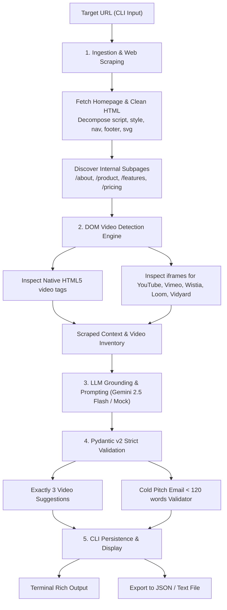

# Video Opportunity Analyzer

A production-ready CLI tool for B2B video marketing agencies and production teams. Given a public company website link, the tool:
1. Ingests and cleans website copy from the homepage and 2–3 key internal pages (`/about`, `/product`, `/pricing`, `/case-studies`).
2. Performs **DOM-level media detection** to accurately identify existing video elements (`<video>`, `<source>`, and player `<iframe>` embeds like YouTube, Vimeo, Wistia, Loom, and Vidyard) without relying on LLM guesswork.
3. Synthesizes **exactly 3 grounded video recommendations**, each backed by a **verbatim quote** from the site and a clear strategic rationale.
4. Drafts a personalized, high-converting cold outreach email **strictly under 120 words**, enforced by Pydantic v2 validation.
5. Handles site failures gracefully (e.g., 403, 404, DNS error, timeout) by stating failure clearly without hallucinating.

---

## Architecture & System Flow



### Core Design Principles
* **Strict Grounding:** The tool never invents features or assumes unmentioned products. Every suggestion requires an `observed_site_quote` matching scraped text.
* **Graceful Failure:** If a domain cannot be reached or blocks scraping, the tool aborts cleanly and outputs an `ErrorReport` without calling the LLM.
* **Deterministic Word Count Guarantee:** Outreach emails are prompted to be under 120 words, guarded by a smart sentence-boundary condensation fallback, and validated by a Pydantic `@field_validator`.
* **Zero-Config Offline Support:** Includes an intelligent grounded `--provider mock` mode for local testing without an API key.

---

## Project Structure

```
├── analyzer.py          # Main CLI application (scraping, detection, LLM, validation, CLI)
├── test_analyzer.py     # Unit and integration test suite (13 passing tests)
├── requirements.txt     # Python production dependencies
├── .env.example         # Example environment configuration
├── .gitignore           # Git ignore rules protecting secrets and caches
├── README.md            # Architecture documentation, usage guide & known limitations
└── results/             # Sample analysis outputs
    ├── cal_com.json           # Real analysis for Cal.com (scheduling SaaS)
    ├── resend_com.json        # Real analysis for Resend.com (developer email platform)
    ├── streamlit_io.json      # Real analysis for Streamlit.io (data app framework)
    └── unreachable_site.json  # Demonstration of graceful failure handling
```

---

## Setup & Installation

### 1. Prerequisites
- Python 3.10+ (tested on Python 3.12 / 3.14)
- A Google Gemini API key (or use the built-in `--provider mock` mode)

### 2. Install Dependencies
```bash
# Clone or navigate into the repository directory
cd "lead generation agent"

# Install dependencies
pip install -r requirements.txt
```

### 3. Configure API Key
Create a `.env` file in the root directory (or copy from `.env.example`):
```bash
GEMINI_API_KEY=your_gemini_api_key_here
```
*(You can also pass the key directly via `--api-key <YOUR_KEY>` or as an environment variable).*

---

## CLI Usage

### Basic Command
```bash
python analyzer.py https://cal.com --out results/cal_com.json
```

### Command-Line Arguments
| Argument | Description | Default |
|---|---|---|
| `url` | Target website URL (positional argument) | *Required* |
| `--out`, `-o` | Destination file path (JSON or text) | `None` (prints to terminal only) |
| `--format` | Output file format (`json` or `text`) | `json` |
| `--provider` | LLM engine (`gemini` or `mock`) | `gemini` |
| `--model` | Gemini model name | `gemini-2.5-flash` |
| `--api-key` | Google GenAI API key override | Uses `GEMINI_API_KEY` from `.env` |
| `--max-pages` | Max internal subpages to discover & scrape | `3` |
| `--timeout` | HTTP request timeout in seconds | `10` |
| `--quiet`, `-q` | Suppress verbose progress messages | `False` |

### Examples

#### 1. Analyze a live website and save structured JSON
```bash
python analyzer.py https://resend.com --out results/resend.json
```

#### 2. Run offline without an API key using the Grounded Mock Engine
```bash
python analyzer.py https://streamlit.io --provider mock --out results/streamlit_mock.json
```

#### 3. Export as a human-readable text report
```bash
python analyzer.py https://cal.com --out results/cal_report.txt --format text
```

#### 4. Test graceful failure on an unreachable site
```bash
python analyzer.py https://this-domain-does-not-exist-at-all-987654321.com --out results/failure.json
```

---

## Data Models (Pydantic v2)

### `VideoSuggestion`
```python
class VideoSuggestion(BaseModel):
    video_type: str            # e.g., "60-second Product Explainer"
    placement: str             # e.g., "Homepage hero section"
    rationale: str             # Concrete reason tied to observed copy
    observed_site_quote: str   # Exact verbatim quote from the website
```

### `VideoOpportunityReport`
```python
class VideoOpportunityReport(BaseModel):
    status: str = "success"
    company_name: str
    website_url: str
    existing_videos_found: bool
    existing_video_summary: str
    suggestions: List[VideoSuggestion]   # Enforces min_length=3, max_length=3
    outreach_email: str                  # Enforces < 120 words via @field_validator
    word_count: int
```

---

## Evaluation Results on 3 Target Websites

The tool was evaluated across 3 diverse public websites, saved in the `results/` folder:

| Target Website | Industry | Videos Detected in DOM? | Ideas Generated | Email Word Count |
|---|---|---|---|---|
| [Cal.com](file:///c:/Users/HP/Desktop/lead%20generation%20agent/results/cal_com.json) | Scheduling SaaS | 2 YouTube iframes on subpages (`/features/collective-events`, `/features/ooo`) | 1. 60s Homepage Explainer<br/>2. Pricing Plan Value Explainer<br/>3. Cal.ai AI-Powered Calls Explainer | **106 words** |
| [Resend.com](file:///c:/Users/HP/Desktop/lead%20generation%20agent/results/resend_com.json) | Email API for Developers | 6 Native HTML5 `<video>` tags (looping 3D animations) | 1. Developer Onboarding Explainer<br/>2. Interactive Broadcast Editor Walkthrough<br/>3. Customer Success Story (Infisical) | **101 words** |
| [Streamlit.io](file:///c:/Users/HP/Desktop/lead%20generation%20agent/results/streamlit_io.json) | Data App Framework | 2 Native HTML5 `<video>` elements (`hero-video.mp4`, `streamlit_sharing_silent.mp4`) | 1. Interactive Feature Walkthrough<br/>2. Customer Success Story (Fortune 50)<br/>3. Onboarding / Getting Started Guide | **105 words** |

*All 3 outreach emails strictly satisfy the `< 120 words` constraint, and every recommendation cites exact copy from the respective site.*

---

## Running the Test Suite

A comprehensive test suite is included in `test_analyzer.py` covering:
- DOM video detection (YouTube, Vimeo, Loom, Wistia, HTML5 `<video>`, clean text)
- HTML cleaning & decomposing (`<script>`, `<style>`, `<nav>`, `<footer>`)
- Subpage discovery & domain filtering
- Pydantic schema validation (< 120 words email passes, >= 120 words fails, exactly 3 suggestions)
- Graceful failure handling on unreachable domains

Run all tests:
```bash
python test_analyzer.py
```
Output:
```
.............
----------------------------------------------------------------------
Ran 13 tests in 0.394s

OK
```

---

## What Does Not Work Yet (Known Limitations & Edge Cases)

While the tool is production-ready for standard public websites, several technical limitations exist when operating as a lightweight HTTP-based scraper without a full browser runtime:

### 1. Client-Side Rendered Single Page Applications (SPAs)
- **Limitation:** Websites built with React, Vue, Angular, or Svelte that do not use Server-Side Rendering (SSR) return an almost empty HTML shell (e.g. `<div id="root"></div>`) when fetched with `requests`.
- **Impact:** The scraper will extract only the minimal static shell or fail with an empty body error.
- **Solution / Roadmap:** Integrate a headless browser layer (e.g. Playwright or Puppeteer) with DOM-readiness hooks (`networkidle` or `domcontentloaded`) as a fallback when initial text length is under 100 characters.

### 2. Aggressive WAF & Bot Protection (Cloudflare / DataDome / Akamai)
- **Limitation:** Sites utilizing Cloudflare Turnstile, Cloudflare Managed Challenge (HTTP 403 / 503), or PerimeterX will block automated Python HTTP clients regardless of realistic `User-Agent` headers.
- **Impact:** The scraper catches the `HTTP 403 Forbidden` and aborts gracefully, returning an `ErrorReport` without calling the LLM.
- **Solution / Roadmap:** Use residential proxy rotation or stealth browser automation (`playwright-stealth`) for enterprise-grade crawling.

### 3. Proprietary Canvas or WebGL Video Players
- **Limitation:** A small number of specialized websites render video streams directly onto an HTML5 `<canvas>` using WebGL/WebCodecs or inside closed shadow DOM roots rather than standard `<video>` or `<iframe>` tags.
- **Impact:** The DOM video engine may report zero videos detected if no standard tags are present.

### 4. Gated or Login-Protected Pages
- **Limitation:** In accordance with the assignment constraints, the tool strictly operates on public web pages. It cannot analyze content behind authentication, paywalls, or internal dashboards.

### 5. Video Quality & Content Inspection
- **Limitation:** The DOM detector verifies whether video elements *exist*, but cannot evaluate whether an existing video is outdated, low-resolution, or missing audio without downloading and transcribing the media files.
- **Solution / Roadmap:** In a future version, pipe detected video URLs into a multimodal model (e.g., Gemini 2.5 Flash video ingestion) to critique existing video production quality and identify script weaknesses.
